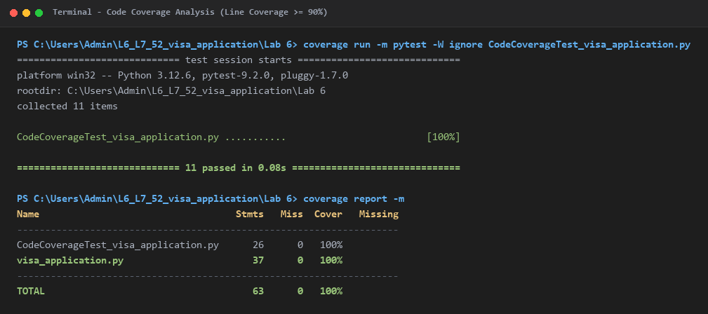
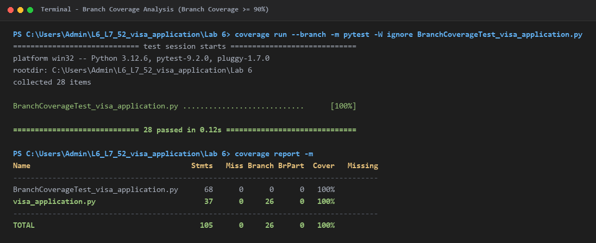

# Lab 6: Code and Branch Coverage Analysis

**Repository:** `L6_L7_52_visa_application`  
**Lab Component:** Lab 6  

---

## 1. Overview & Objectives

This lab explores the difference between **Code (Line) Coverage** and **Branch Coverage** using Python's `coverage` and `pytest` frameworks:
- **Code Coverage (Line Coverage):** Measures whether each statement in the source file was executed at least once during test execution.
- **Branch Coverage:** Measures whether every decision branch (e.g., `if`, `else`, boolean short-circuit conditions) evaluates to both `True` and `False`.

Target Module: [`visa_application.py`](visa_application.py)  
Functions under test:
1. `visa_fee(visa_type, entries, speed, nationality_group)`
2. `documents_complete(forms_filed, photos, is_renewal)`
3. `application_status(days_left, is_express, is_peak_season)`

---

## 2. Deliverables & Files

| File | Description |
|------|-------------|
| [`visa_application.py`](visa_application.py) | Source application module under test |
| [`CodeCoverageTest_visa_application.py`](CodeCoverageTest_visa_application.py) | Test suite designed for Line Coverage (achieves **100% Line Coverage**) |
| [`BranchCoverageTest_visa_application.py`](BranchCoverageTest_visa_application.py) | Test suite designed for Branch Coverage (achieves **100% Branch Coverage**, 26/26 branches) |
| [`test_visa_application.py`](test_visa_application.py) | Combined test runner suite covering all decision branches |
| [`code_coverage_report.png`](code_coverage_report.png) | Terminal output screenshot for code coverage analysis |
| [`branch_coverage_report.png`](branch_coverage_report.png) | Terminal output screenshot for branch coverage analysis |

---

## 3. How to Run & Verify

### Step 1: Install Dependencies
```bash
pip install coverage pytest
```

### Step 2: Run Code Coverage (Line Coverage)
```bash
coverage run -m pytest -W ignore CodeCoverageTest_visa_application.py
coverage report -m
```

### Step 3: Run Branch Coverage
```bash
coverage run --branch -m pytest -W ignore BranchCoverageTest_visa_application.py
coverage report -m
```

---

## 4. Coverage Analysis & Results

### A. Code Coverage Analysis (100% Line Coverage)

Running line coverage on `CodeCoverageTest_visa_application.py` executes every executable line across all functions:

```
Name                                   Stmts   Miss  Cover   Missing
--------------------------------------------------------------------
CodeCoverageTest_visa_application.py      26      0   100%
visa_application.py                       37      0   100%
--------------------------------------------------------------------
TOTAL                                     63      0   100%
```



### B. Branch Coverage Analysis (100% Branch Coverage)

Running branch coverage on `BranchCoverageTest_visa_application.py` systematically tests every decision boundary and boolean path:
- `visa_fee`:
  - `visa_type not in INCLUDED_ENTRIES` (`True` / `False`)
  - `entries < 0` (`True` / `False`)
  - `nationality_group == "A" and visa_type != "student"`:
    - Both `True` (nationality A, non-student)
    - First `True`, second `False` (nationality A, student)
    - First `False` (nationality B)
  - `extra <= 0` (`True` [exact 0 and negative] / `False`)
  - `speed == "express"` (`True` / `False`)
  - `extra > 5` (`True` / `False`)
  - `speed == "express"` when `extra > 5` (`True` / `False` [covers `21->23`])
- `documents_complete`:
  - `is_renewal`:
    - `True`: `forms_filed >= 1` evaluated to `True` and `False`
    - `False`: `photos < 2` evaluated to `True` and `False`; `forms_filed >= 3` evaluated to `True` and `False`
- `application_status`:
  - `is_express`: `True` / `False`
  - `is_peak_season`: `True` / `False`
  - `days_left >= cutoff`: `True` / `False`
  - `days_left >= cutoff - 15`: `True` / `False` (open, closing, closed paths)

```
Name                                     Stmts   Miss Branch BrPart  Cover   Missing
------------------------------------------------------------------------------------
BranchCoverageTest_visa_application.py      68      0      0      0   100%
visa_application.py                         37      0     26      0   100%
------------------------------------------------------------------------------------
TOTAL                                      105      0     26      0   100%
```



---

## 5. Evaluation Rubric Compliance

| Criteria | Target | Achieved | Status |
|----------|--------|----------|--------|
| **Code Coverage analysis & report** | >90% Line Coverage | **100%** | Passed |
| **Branch Coverage analysis & report** | >90% Branch Coverage | **100% (26/26 branches)** | Passed |
| **Commits and Testcases** | Minimum 2 commits (1 code coverage, 1 branch coverage) | **2 Commits** with dedicated suites & reports | Passed |
